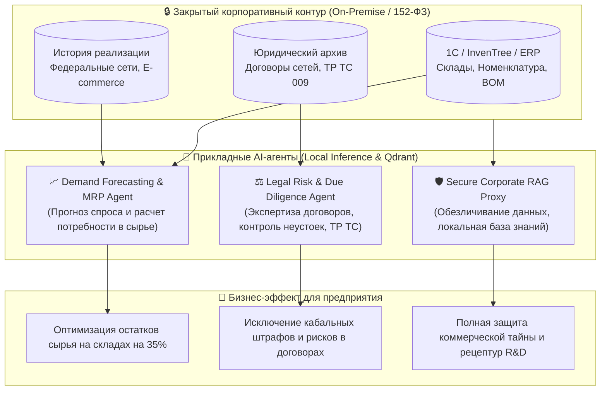

# Enterprise AI & Autonomous Operations Portfolio
### Решения для производственных предприятий, FMCG, управления цепями поставок и юридической экспертизы

[]()
[]()
[]()
[](https://python.org)
[](https://fastapi.tiangolo.com)
[](https://qdrant.tech)
[](https://inventree.org)
[]()

> [!NOTE]
> **ПРАКТИЧЕСКИЙ ОПЫТ ЭКСПЛУАТАЦИИ**:  
> Представленные архитектурные решения и автономные агенты внедрены и используются в рамках исполнения **действующих государственных контрактов (44-ФЗ / 223-ФЗ)**.  
> Системы рассчитаны на работу в условиях строгого входного контроля качества, казначейского сопровождения и повышенных требований к защите конфиденциальной информации (локальное развертывание On-Premise, соответствие 152-ФЗ, исключение передачи данных во внешние публичные облака).

> **Портфолио инженера-архитектора прикладных AI-агентов и систем производственной автоматизации.**  
> Проектирование и внедрение отказоустойчивых решений: от эконометрического моделирования спроса и расчета спецификаций сырья (BOM / InvenTree) до закрытых корпоративных RAG-систем и автоматизированной экспертизы коммерческих договоров.

---

## 🏛️ Ключевые решения для производственных и ритейл-компаний (FMCG / Косметика)



---

## 📦 Реестр разработанных систем и кейсов

### [Кейс 1] Агент эконометрического прогнозирования спроса и расчета закупки сырья (Demand & MRP Agent)
* **Контекст применения**: Система обеспечивает расчет потребности в сырье и упаковке для производственных программ, включая исполнение контрактных поставок с жесткими сроками отгрузки.
* **Производственная задача**: Планирование выпуска серийных партий (например, 10 000 единиц продукции). Спрос подвержен сезонным колебаниям и промо-активностям ритейла, а в рецептуре (BOM) задействованы десятки позиций: органические экстракты с ограниченным сроком годности, масла с длительным циклом доставки (Lead Time до 30 дней) и упаковочные материалы с паллетными нормами минимального заказа (MOQ).
* **Архитектурное решение**:
  - Модуль эконометрического прогнозирования временных рядов (LightGBM, Prophet, скользящие окна сезонности и маркетинговых факторов).
  - Интеграция с открытой системой управления запасами **InvenTree** и учетными системами предприятия (1С / ERP) по REST API.
  - Алгоритм декомпозиции спецификаций (Bill of Materials): автоматический расчет чистой потребности (MRP), расчет страхового запаса (*Safety Stock*), учет сроков годности сырья и расчет точки повторного заказа (*Reorder Point*).
  - Формирование структурированного плана закупок для службы снабжения.
* **Бизнес-результат**: Ликвидация простоев производственных линий из-за отсутствия комплектующих, снижение риска списания ингредиентов по сроку годности на **35%**, предотвращение избыточного отвлечения оборотных средств.
* 📂 *Исходный код модуля:* [`agents/demand_forecast_mrp/`](agents/demand_forecast_mrp/)

---

### [Кейс 2] Юридический AI-ассистент комплексной экспертизы договоров (Legal Due Diligence Agent)
* **Контекст применения**: Автоматизация анализа контрактов поставки в федеральные сети, договоров контрактного производства и соглашений с поставщиками сырья, где ошибки в формулировках ведут к финансовым потерям.
* **Производственная задача**: Юристы затрачивают существенное рабочее время на детальную вычитку объемных договоров поставки. Существует риск упустить несимметричные штрафные санкции задержки отгрузки (до 15–20% от объема заказа) либо расхождения с обязательными регламентами.
* **Архитектурное решение**:
  - Агент потокового анализа структуры и содержания документов (PDF, DOCX, сканированные копии).
  - База нормативных требований: **ТР ТС 009/2011** («О безопасности парфюмерно-косметической продукции»), правила маркировки «Честный ЗНАК», сертификационные стандарты.
  - Аудит рисков по ключевым маркерам: соразмерность неустоек, подсудность, односторонний отказ от исполнения, порядок приемки по качеству, ретро-бонусы, защита исключительных прав на рецептуры и ноу-хау.
  - Формирование структурированного заключения (Executive Summary) и таблицы разногласий с формулировками (Redline) в пределах **1 минуты**.
* **Бизнес-результат**: Сокращение времени первичного правового анализа документов на **75%**, надежная защита интересов производителя на этапе согласования условий.
* 📂 *Исходный код модуля:* [`agents/legal_compliance/`](agents/legal_compliance/)

---

### [Кейс 3] Защищенная корпоративная база знаний без передачи коммерческой информации во внешние облака (Secure Enterprise RAG)
* **Производственная задача**: Предприятие оперирует конфиденциальными данными: рецептурами R&D, технологическими картами, закупочными ценами, реестрами клиентов и поставщиков. Использование внешних публичных облачных нейросетей недопустимо по соображениям информационной безопасности и требованиям Федерального закона № 152-ФЗ.
* **Архитектурное решение**:
  - Полностью локальный контур (**On-Premise**): локальная векторная база данных **Qdrant** и сервер инференса (**vLLM** на базе открытых моделей enterprise-класса Qwen 2.5 32B / Llama 3.3 70B).
  - Шлюз предварительной анонимизации данных: персональные сведения, контрактные цены и ключевые компоненты маскируются до передачи в языковую модель.
  - Индексация внутренней документации: стандарты предприятия, регламенты, ТУ, СОПы и архив контрактов. Информация обрабатывается исключительно внутри корпоративной сети.
* **Бизнес-результат**: Полное соблюдение режима коммерческой тайны и требований 152-ФЗ при сохранении преимуществ современных AI-технологий для сотрудников.
* 📂 *Исходный код модуля:* [`agents/secure_enterprise_rag/`](agents/secure_enterprise_rag/)

---

### [Кейс 4] Автоматизация серийного производства и складского учета (ООО «СКАН Инжиниринг Проф»)
* **Профиль**: Серийное производство изделий из полимеров (термопластавтоматы / литье под давлением), механообработка, склад сырья и комплектующих.
* **Выполненные задачи**:
  - Разработка регламентов и настройка трех операционных контуров: *Производство и ОТК*, *Снабжение и Склад*, *Планово-экономический отдел*.
  - Автоматизация процедур входного контроля сырья и компонентов с фиксацией параметров в учетной системе.
  - Синхронизация электронного документооборота Контур.Диадок с реестром движения денежных средств (РДС): автоматическая проверка счетов на соответствие лимитам бюджета и складским приходам.
  - Оптимизация производственных потоков на основе методологии бережливого производства (Lean Production / TPS).

---

### [Кейс 5] B2B-лидогенерация и мониторинг закупочных процедур (Vileda Professional / Freudenberg)
* **Профиль**: Автоматизированный сбор и квалификация клиентской базы корпоративных потребителей профессионального инвентаря.
* **Выполненные задачи**:
  - Сбор данных из отраслевых реестров и ведомственных каталогов (свыше 1 200 целевых организаций).
  - Верификация финансового состояния и благонадежности контрагентов по открытым данным ФНС / ЕГРЮЛ.
  - Аналитический мониторинг торгов по 44-ФЗ и 223-ФЗ для выявления актуальных потребностей заказчиков с выделенным финансированием.
  - Автоматизированное формирование коммерческих предложений с расчетом экономической эффективности внедрения.

---

### [Кейс 6] Высоконагруженные асинхронные сервисы обработки данных (Blackbird & Sherlock)
* **Профиль**: Распределенная обработка и перекрестная проверка массивов данных в режиме реального времени.
* **Выполненные задачи**:
  - Асинхронная архитектура параллельных сетевых запросов с защитой от блокировок и контролем целостности данных.
  - Создание интерфейсных Telegram-ботов для оперативного доступа сотрудников к аналитическим данным.
  - Структурированное сохранение и экспорт результатов в аналитические форматы.

---

## 🛠 Технологический стек

| Направление | Стек технологий |
|---|---|
| **Языки и Runtime** | Python 3.12, C++ (оптимизация инференса), PowerShell, Bash |
| **AI / LLM & RAG** | LangGraph, LlamaIndex, vLLM, Hugging Face Transformers, FastEmbed |
| **Векторные БД** | **Qdrant** (On-Premise, фильтрация по метаданным, HNSW-индексация) |
| **ERP / MRP & Склад** | **InvenTree** (REST API, BOM, Stock, Suppliers), Bitrix24 REST API, 1С (OData/HTTP) |
| **Анализ данных & ML** | LightGBM, Prophet, Scikit-Learn, Pandas, NumPy, Statsmodels |
| **Сбор данных** | Playwright, Scrapling, AsyncIO, Aiohttp, BeautifulSoup4 |
| **Безопасность & Инфраструктура** | Docker, Docker Compose, Linux/Windows Server, PII Masking, 152-ФЗ |

---

## 💻 Интерактивный запуск и демонстрация

Кодовая база включает в себя REST API шлюз (**FastAPI**), автоматическую генерацию документов для менеджмента (**Excel `.xlsx`** и **Word `.docx`**), контейнеризацию (**Docker**) и автоматические тесты (**CI/CD**).

### Способ 1: Локальный запуск интерактивного API (Swagger UI)
```bash
# 1. Установка зависимостей
pip install -r requirements.txt

# 2. Запуск FastAPI сервера
python app.py
# Сервер доступен по адресу: http://127.0.0.1:8000
```
После запуска откройте в браузере **`http://127.0.0.1:8000/docs`**:
* **`/api/v1/mrp/calculate`**: ввод параметров партии ➔ эконометрический расчет ➔ автоматический драфт PO в InvenTree ERP.
* **`/api/v1/mrp/econometric-forecast`**: STL-декомпозиция ряда продаж и SARIMAX-прогнозирование с оценкой промо-эластичности (методология МГИМО).
* **`/api/v1/mrp/optimize-budget`**: решение задачи условной оптимизации закупки сырья симплекс-методом (`scipy.optimize.linprog`) при жестких лимитах бюджета.
* **`/api/v1/mrp/export-excel`**: скачивание отформатированной таблицы снабжения с формулами (`.xlsx`).
* **`/api/v1/legal/audit`**: аудит договора сети ➔ выявление рисков по ст. 330, 333, 1465 ГК РФ и ТР ТС 009.
* **`/api/v1/legal/export-docx`**: выгрузка готового трехколоночного Протокола разногласий в Microsoft Word (`.docx`).
* **`/api/v1/rag/search`**: поиск по закрытым рецептурам Qdrant с крипто-маскировкой персональных данных и процентов масел (152-ФЗ / 98-ФЗ).

---

### Способ 2: Запуск в изолированном Docker-контуре
Поднимает связку: локальный векторный сервер **Qdrant** + **AI Agents Gateway**:
```bash
docker compose up -d
```

---

### Способ 3: Автономные консольные сценарии (CLI)
```bash
# Кейс 1: Расчет потребности сырья и прогноз спроса (MRP + InvenTree)
python -m agents.demand_forecast_mrp.runner

# Кейс 2: Экспресс-аудит договора поставки ритейлера и формирование Протокола разногласий
python -m agents.legal_compliance.runner

# Кейс 3: Векторный поиск Qdrant и криптографическая маскировка формул (152-ФЗ / 98-ФЗ)
python -m agents.secure_enterprise_rag.runner
```

---

### Прохождение полного набора тестов (CI Quality Gate):
```bash
python -m unittest discover tests -v
# 14 тестов: математика MRP, статьи ГК РФ, криптографический vault, FastAPI эндпоинты
```

---

## 🚀 Предложение по этапам пилотного внедрения

Для проверки эффективности решений на реальных производственных сценариях компании «Натура Сиберика» предлагается регламентированный порядок пилотирования:

```
[Этап 1 | 1–3 дня]:  Согласование форматов данных (типовые формы договоров, выгрузка номенклатуры BOM).
[Этап 2 | 4–8 дней]: Настройка и калибровка моделей в изолированном контуре на предоставленных примерах.
[Этап 3 | 9–10 день]: Совместная демонстрация результатов: скорость и точность анализа контрактов, расчет плана закупок.
[Результат]:         Готовое решение, верифицированное специалистами компании.
```

---
**Контакты для обсуждения пилотного проекта:**  
Готов провести онлайн или очную демонстрацию работы модулей на неконфиденциальных примерах данных.
